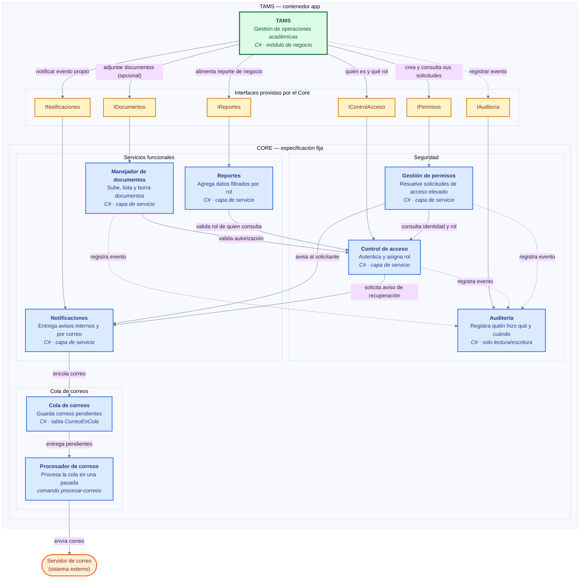

# TAMS

Sistema de Gestión Académica Docente para la administración de asignaciones, cursos, horarios y calificaciones. Proyecto de Programación III.

## Diagrama de componentes



### Cómo leer el diagrama

| Elemento | Significado |
|---|---|
| Recuadro verde (`TAMS`) | El módulo de negocio: tu dominio, tus entidades y tu máquina de estados. |
| Recuadros amarillos | Las interfaces que expone el Core. Es lo único que TAMS puede usar de él. |
| Recuadros azules | Las seis piezas del Core, con su responsabilidad y su tecnología. |
| Recuadro naranja (`Servidor de correo`) | Un sistema externo, fuera de la aplicación. |
| Flecha sólida (`-->`) | Una llamada directa: quien envía la flecha necesita una respuesta de quien la recibe para completar su operación. |
| Flecha punteada (`-.->`) | Un registro que no bloquea el flujo: se avisa a Auditoría, pero la operación no depende de esa respuesta. |
| Texto sobre la flecha | El propósito de esa comunicación, no el nombre técnico del método. |

No se dibuja ninguna base de datos ni volumen como componente: cada pieza
del Core guarda sus propios datos, de forma independiente y sin que otra
pieza pueda leerlos directamente (RD-01, RD-03).

## Inicio rápido con Docker

La forma recomendada de ejecutar TAMS es el contenedor: no necesitas instalar
.NET, SQL Server ni un servidor SMTP. Solo necesitas **Docker Desktop** con
Docker Compose v2 (Windows/macOS) o Docker Engine con el plugin Compose
(Linux).

### 1. Prepara el archivo de entorno

En PowerShell:

```powershell
Copy-Item .env.example .env
```

En bash:

```bash
cp .env.example .env
```

`.env` no se versiona (`git check-ignore -v .env`). El archivo de ejemplo ya
trae valores de plantilla que sirven para probar; no contiene credenciales
reales. Si más adelante configuras SMTP o Calendarific, cambia solo los
valores correspondientes dentro de `.env`.

### 2. Levanta los servicios

```powershell
docker compose up -d --build
```

La primera vez compila la imagen. La API queda publicada en
**`http://localhost:5132`**. No ejecutes al mismo tiempo la API local con
`dotnet run`: ambas usan el puerto `5132`.

En bash el comando es el mismo:

```bash
docker compose up -d --build
```

### 3. Comprueba que está listo

```powershell
docker compose ps
docker compose logs --no-color app | Select-String -SimpleMatch "Migraciones de Core y Negocio aplicadas"
```

En bash:

```bash
docker compose ps
docker compose logs --no-color app | grep "Migraciones de Core y Negocio aplicadas"
```

Debes ver los tres servicios (`db`, `app` y `correos`) y una línea como:

```text
Migraciones de Core y Negocio aplicadas correctamente en el intento 1.
```

El servicio `db` aparece como `healthy`; `app` y `correos` como `Up`. Si
`app` todavía no ha aplicado las migraciones, espera unos segundos y repite
el segundo comando. La API no tiene una interfaz web propia: se prueba con
las rutas HTTP de este documento.

### 4. Detén el entorno

Para detener los contenedores conservando la base de datos y los documentos:

```powershell
docker compose down
```

Para detener y **borrar** la base de datos y los documentos (volúmenes
incluidos):

```powershell
docker compose down -v
```

En bash:

```bash
docker compose down       # conserva la base de datos y los documentos
docker compose down -v    # borra también los volúmenes
```

### Qué hay dentro del contenedor

| Servicio | Imagen / comando | Para qué | Puerto publicado |
|---|---|---|---|
| `db` | `mcr.microsoft.com/mssql/server:2022-latest` | SQL Server con los esquemas `core` y `negocio` | Ninguno: no es accesible desde el host |
| `app` | `Dockerfile` → `dotnet Tams.Api.dll` | API web | `5132:8080` |
| `correos` | La misma imagen; ejecuta `dotnet Tams.Api.dll procesar-correos` en un bucle cada 15 s | Procesa la cola `core.CorreosEnCola` | Ninguno |

Solo `app` publica un puerto. `db` queda en la red interna de Compose y se
administra con `docker compose exec db ...`; no se expone `1433` al host.

Hay dos volúmenes nombrados:

- `tams_sql_datos`: datos de SQL Server (`/var/opt/mssql`).
- `tams_documentos`: archivos subidos (`/app/almacen`).

`docker compose down` conserva ambos volúmenes; `docker compose down -v` los
elimina. Al arrancar `app`, las migraciones de los dos `DbContext` se aplican
automáticamente, con reintentos para esperar a que SQL Server esté listo
(RD-09). El servicio `correos` **no** es un `BackgroundService` con
reintentos propios: repite el comando de una sola pasada `procesar-correos`
cada 15 segundos.

### Correos sin SMTP: leer el enlace y el código en el log

Con el `.env.example`, `TAMS_SMTP_HOST` está vacío. En ese modo los correos
no salen a Internet: el enviador escribe el destinatario, el asunto y el
cuerpo completo (incluido el enlace) en el log del servicio `correos`, y
marca el correo como enviado. Esto permite probar registro, activación y
recuperación sin cuenta de correo.

Después de registrar un usuario, espera a que el servicio `correos` haga su
siguiente pasada (hasta 15 segundos) y lee el log:

```powershell
Start-Sleep -Seconds 20
docker compose logs --no-color correos | Select-String -SimpleMatch "api/cuentas/activar?codigo="
docker compose logs --no-color correos | Select-String -SimpleMatch "Asunto: Recupera tu contrase"
```

El segundo patrón evita la letra `ñ` para que funcione con cualquier
codificación de consola de PowerShell. Para extraer el enlace de activación
y el código de recuperación:

```powershell
$linea = docker compose logs --no-color correos | Select-String -SimpleMatch "api/cuentas/activar?codigo=" | Select-Object -Last 1
[regex]::Match($linea.Line, "activar\?codigo=([^\s]+)").Groups[1].Value

$linea = docker compose logs --no-color correos | Select-String -SimpleMatch "Asunto: Recupera tu contrase" | Select-Object -Last 1
[regex]::Match($linea.Line, "es: ([A-Za-z0-9_-]+)\.").Groups[1].Value
```

Para activar el envío real, llena `TAMS_SMTP_HOST`, `TAMS_SMTP_PORT`,
`TAMS_SMTP_USUARIO`, `TAMS_SMTP_CONTRASENA` y `TAMS_SMTP_REMITENTE` en
`.env`, y recrea los servicios:

```powershell
docker compose up -d
```

Las credenciales SMTP solo las usa el proceso `procesar-correos`; la API web
no las necesita. Si el SMTP no responde, el comando sale con código `1` y el
correo queda en estado `Pendiente` para la siguiente pasada.

### Variables de entorno: prioridad y limpieza

Docker Compose lee `.env`, pero **una variable definida en la terminal tiene
prioridad sobre `.env`**. Si en tu terminal quedaron definidas variables como
`TAMS_SMTP_HOST`, `TAMS_JWT_SECRETO` o `TAMS_API_FERIADOS_CLAVE`, Compose usará
esas y no las del archivo. Para quitarlas solo de esa terminal de PowerShell:

```powershell
Remove-Item Env:TAMS_SMTP_HOST, Env:TAMS_SMTP_PORT, Env:TAMS_SMTP_USUARIO, Env:TAMS_SMTP_CONTRASENA, Env:TAMS_SMTP_REMITENTE, Env:TAMS_JWT_SECRETO, Env:TAMS_API_FERIADOS_CLAVE -ErrorAction SilentlyContinue
```

Ejecuta esa limpieza en la misma terminal antes de `docker compose up` si
quieres que se usen exactamente los valores de `.env`. Si cambias `.env`,
vuelve a ejecutar `docker compose up -d` para recrear los contenedores con
los nuevos valores.

### Crear el primer Administrador dentro del contenedor

El registro siempre crea cuentas con rol `Estandar`; nadie puede
autopromoverse. Para tener el primer Administrador en una base limpia:

1. Registra una cuenta. En modo sin SMTP puedes usar un correo de ejemplo:

   ```powershell
   $body = @{ nombre = "Admin"; correo = "admin@ejemplo.com"; contrasena = "Admin123!" } | ConvertTo-Json
   Invoke-RestMethod -Method Post -Uri "http://localhost:5132/api/cuentas/registro" -ContentType "application/json" -Body $body
   ```

   La respuesta es `{"mensaje":"Cuenta creada. Revisa tu correo para activarla."}`.
   Si configuraste SMTP real, usa un correo que puedas recibir.

2. Espera la pasada de `correos`, extrae el enlace de activación y ábrelo:

   ```powershell
   Start-Sleep -Seconds 20
   $linea = docker compose logs --no-color correos | Select-String -SimpleMatch "api/cuentas/activar?codigo=" | Select-Object -Last 1
   $codigo = [regex]::Match($linea.Line, "activar\?codigo=([^\s]+)").Groups[1].Value
   Invoke-RestMethod -Method Get -Uri "http://localhost:5132/api/cuentas/activar?codigo=$codigo"
   ```

3. Confirma que puedes iniciar sesión:

   ```powershell
   $login = Invoke-RestMethod -Method Post -Uri "http://localhost:5132/api/cuentas/login" -ContentType "application/json" -Body (@{ correo = "admin@ejemplo.com"; contrasena = "Admin123!" } | ConvertTo-Json)
   ```

4. Asígnale el rol con SQL. Sustituye `<la MSSQL_SA_PASSWORD de tu .env>`
   por el valor que pusiste en `.env` (no lo escribas en ningún archivo
   versionado):

   ```powershell
   docker compose exec db /opt/mssql-tools18/bin/sqlcmd -S localhost -U sa -P "<la MSSQL_SA_PASSWORD de tu .env>" -C -I -d Tams -Q "UPDATE core.Usuarios SET Rol = 'Administrador' WHERE Correo = 'admin@ejemplo.com';"
   ```

   `-I` activa `QUOTED_IDENTIFIER` en `sqlcmd`. Sin esa opción, SQL Server
   puede responder `Msg 1934 ... QUOTED_IDENTIFIER` al actualizar tablas con
   índices filtrados. El rol vive en la base; el token anterior conserva el
   rol viejo, así que **inicia sesión otra vez** después del `UPDATE` para
   obtener un token de Administrador.

5. Vuelve a iniciar sesión y conserva el token en `$admin`:

   ```powershell
   $login = Invoke-RestMethod -Method Post -Uri "http://localhost:5132/api/cuentas/login" -ContentType "application/json" -Body (@{ correo = "admin@ejemplo.com"; contrasena = "Admin123!" } | ConvertTo-Json)
   $admin = @{ Authorization = "Bearer $($login.token)" }
   ```

## API externa: feriados (Calendarific)

El cálculo de días lectivos consulta los feriados nacionales de República
Dominicana en **Calendarific**, con `country=DO` y `type=national`. La
atribución exigida por el plan gratuito es:

> Datos de feriados proporcionados por Calendarific (calendarific.com)

### Endpoints

| Método y ruta | Rol | Qué hace |
|---|---|---|
| `GET /api/anios-escolares` | Administrador | Lista los años escolares con `id`, `nombre`, `fechaInicio`, `fechaFin` y `esActivo`. |
| `GET /api/anios-escolares/{id}/dias-lectivos` | Administrador | Calcula los días lectivos del año indicado. |

El cálculo cuenta los días de lunes a viernes entre `fechaInicio` y
`fechaFin`, ambos inclusive, y resta los feriados nacionales distintos que
caen de lunes a viernes dentro del rango. Se hace **una llamada a
Calendarific por cada año calendario** que toca el rango; si el año escolar
cruza de 2026 a 2027, se consultan los dos años.

Ambos endpoints exigen el rol **Administrador** porque `[RequiereRol]` acepta
un solo rol (`AllowMultiple = false`); no existe una combinación
Administrador + Estándar. Un usuario Estándar recibe **403**.

Limitación conocida de la fuente: Calendarific puede devolver el mismo
feriado dos veces cuando se traslada de fecha. Por ejemplo, en 2027
`Duarte's Day` aparece el 25 de enero como «Day off for Duarte's Day» y el
26 de enero como «Duarte's Day»; ambos días se descuentan si caen entre
semana. El cálculo no intenta deduplicar por nombre, solo por fecha.

### Configurar la clave

`TAMS_API_FERIADOS_CLAVE` es la clave de Calendarific. Se obtiene gratis en
[calendarific.com/register](https://calendarific.com/register). Guárdala en
`.env` (archivo ignorado por Git) o en una variable de entorno de la
terminal:

```text
TAMS_API_FERIADOS_CLAVE=<tu-clave-gratuita>
```

`docker-compose.yml` pasa esa variable al servicio `app`; el contenedor la
recibe desde `.env` o desde la terminal. Después de cambiarla, recrea el
servicio `app`:

```powershell
docker compose up -d
```

La API puede arrancar sin la clave: el proveedor la lee en cada llamada, no
al iniciar. Sin clave, `GET /api/anios-escolares/{id}/dias-lectivos`
responde **503**; el resto del sistema sigue funcionando.

### Crear un año escolar de prueba

No hay endpoint para crear años escolares. Créalo con SQL dentro del
contenedor. Primero obtén el id:

```powershell
docker compose exec db /opt/mssql-tools18/bin/sqlcmd -S localhost -U sa -P "<la MSSQL_SA_PASSWORD de tu .env>" -C -I -d Tams -Q "IF NOT EXISTS (SELECT 1 FROM negocio.AniosEscolares WHERE Nombre = '2026-2027') INSERT INTO negocio.AniosEscolares (Nombre, FechaInicio, FechaFin, EsActivo, FechaCreacion) VALUES ('2026-2027', '2026-08-17', '2027-06-18', 1, SYSUTCDATETIME()); SELECT Id, Nombre, FechaInicio, FechaFin, EsActivo FROM negocio.AniosEscolares WHERE Nombre = '2026-2027';"
```

`FechaCreacion` es obligatoria: la entidad implementa `ICreacionAuditable` y
la columna no tiene valor por defecto. Si ya cargaste `docs/datos-demo.sql`,
el año `2026-2027` ya existe con otras fechas y el `IF NOT EXISTS` no inserta
otro; usa el id que devuelve el `SELECT`. Si intentas insertar un segundo año
con `EsActivo = 1`, el índice único filtrado lo rechaza.

### Respuesta 200 de ejemplo

Con un año escolar `2026-2027` del `2026-08-17` al `2027-06-18`, una clave
válida y el token de Administrador:

```powershell
$admin = @{ Authorization = "Bearer $($login.token)" }
Invoke-RestMethod -Method Get -Uri "http://localhost:5132/api/anios-escolares/2/dias-lectivos" -Headers $admin
```

Ejemplo real de respuesta 200, copiado tal cual (el `anioEscolarId` puede
ser distinto en tu base; aquí era `2` porque ya existía otro año escolar):

```json
{"anioEscolarId":2,"nombre":"2026-2027","fechaInicio":"2026-08-17","fechaFin":"2027-06-18","diasHabiles":220,"feriadosDescontados":[{"fecha":"2026-09-24","nombre":"Feast of Our Lady of Mercy"},{"fecha":"2026-11-09","nombre":"Day off for Constitution Day"},{"fecha":"2026-12-25","nombre":"Christmas Day"},{"fecha":"2027-01-01","nombre":"New Year's Day"},{"fecha":"2027-01-04","nombre":"Epiphany Holiday"},{"fecha":"2027-01-21","nombre":"Our Lady of Altagracia"},{"fecha":"2027-01-25","nombre":"Day off for Duarte's Day"},{"fecha":"2027-01-26","nombre":"Duarte's Day"},{"fecha":"2027-03-26","nombre":"Good Friday"},{"fecha":"2027-04-30","nombre":"Day off for Labor Day"},{"fecha":"2027-05-27","nombre":"Corpus Christi"}],"diasLectivos":209,"fuente":"Calendarific (calendarific.com)"}
```

### Errores controlados

Sin clave configurada, el endpoint responde **503** con este `ProblemDetails`:

```json
{"type":"https://tools.ietf.org/html/rfc9110#section-15.6.4","title":"Servicio de feriados no configurado","status":503,"detail":"El servicio de feriados no está configurado. Falta la clave de Calendarific.","traceId":"00-748227db39c9f87a8a84f2b19b49e34d-42dd9ac640d12096-00"}
```

Con una clave inválida o con Calendarific caído, responde **502**:

```json
{"type":"https://tools.ietf.org/html/rfc9110#section-15.6.3","title":"Servicio de feriados no disponible","status":502,"detail":"El servicio de feriados no está disponible en este momento. Inténtalo más tarde.","traceId":"00-c17bf87868845cb94ce8f266c7677504-bbe5762d49b03e38-00"}
```

Para provocar el 502 sin usar una clave real, define una clave deliberadamente
inválida solo para esa terminal, recrea `app`, haz la llamada y luego limpia
la variable:

```powershell
$env:TAMS_API_FERIADOS_CLAVE = "clave-invalida"
docker compose up -d app
# espera a que app termine de arrancar
curl.exe -s -w "`nHTTP %{http_code}`n" "http://localhost:5132/api/anios-escolares/1/dias-lectivos" -H "Authorization: Bearer $($login.token)"
Remove-Item Env:TAMS_API_FERIADOS_CLAVE
docker compose up -d app
```

Un año inexistente responde **404**:

```json
{"type":"https://tools.ietf.org/html/rfc9110#section-15.5.5","title":"Año escolar no encontrado","status":404,"detail":"El año escolar no existe.","traceId":"00-d5e852a7a9e95da8780debfade265815-547a0e800229fac8-00"}
```

Sin token la respuesta es **401**; con un token de Estándar es **403**. La
ausencia de clave no impide registrarse, iniciar sesión, gestionar permisos
ni operar las calificaciones: el único afectado es el cálculo de días
lectivos.

## Datos de demostración

El script `docs/datos-demo.sql` prepara un escenario mínimo para probar las
operaciones de calificaciones. No crea usuarios ni contraseñas.

### Antes de ejecutar

1. Las migraciones de los dos esquemas deben estar aplicadas. En el
   contenedor se aplican solas al arrancar; en local usa
   `dotnet ef database update` (ver [Ejecución local](#ejecución-local-con-net-alternativa)).
2. Debe existir un docente **registrado y activado** en `core.Usuarios`, con
   rol `Estandar`. El script no lo crea.
3. El script tiene en la línea 16 el marcador
   `DECLARE @CorreoDocente nvarchar(320) = N'CAMBIAR_POR_CORREO';`. Debes
   sustituirlo por el correo real del docente.

### Cargar el script dentro del contenedor

Registra y activa al docente igual que en el paso del Administrador, usando
por ejemplo `docente@ejemplo.com`. Después crea una copia temporal con el
correo sustituido (sin modificar el archivo versionado), cópiala al
contenedor y ejecútala:

```powershell
$demo = Join-Path $env:TEMP "datos-demo.sql"
$texto = [IO.File]::ReadAllText((Resolve-Path docs/datos-demo.sql), [Text.Encoding]::UTF8).Replace("CAMBIAR_POR_CORREO", "docente@ejemplo.com")
[IO.File]::WriteAllText($demo, $texto, (New-Object System.Text.UTF8Encoding($false)))

docker compose cp $demo db:/tmp/datos-demo.sql
docker compose exec db /opt/mssql-tools18/bin/sqlcmd -S localhost -U sa -P "<la MSSQL_SA_PASSWORD de tu .env>" -C -I -d Tams -i /tmp/datos-demo.sql
```

Si usas SSMS o Visual Studio, abre `docs/datos-demo.sql`, selecciona la base
que contiene los esquemas `core` y `negocio`, cambia la línea 16 y ejecuta
el archivo completo. Si el correo no existe, el script se detiene con el
error **50001** y no inserta nada. Si la asignación de Matemática y el curso
ya pertenece a otro docente, se detiene con el error **50002**. El script es
**idempotente**: puede ejecutarse varias veces sin duplicar los datos.

### Qué crea en una base limpia

| Dato | Filas | Id en una base limpia |
|---|---:|---|
| Centro `Centro Demo TAMS` | 1 | 1 |
| Año escolar activo `2026-2027` | 1 | 1 |
| Curso `1er Grado`, sección `A` | 1 | 1 |
| Materias: `Matemática` (no técnica) y `Programación` (técnica, 3 RA) | 2 | 1 y 2 |
| Estudiantes: `Ana Pérez` y `Luis Gómez`, en ese curso | 2 | 1 y 2 |
| Asignación del docente a `Matemática` en el curso, 4 horas semanales | 1 | 1 |

El script no crea calificaciones: esas se registran con la API. Si la base
no está limpia, reutiliza los registros existentes y los ids pueden ser
distintos de 1 y 2. Para consultar los ids reales:

```powershell
docker compose exec db /opt/mssql-tools18/bin/sqlcmd -S localhost -U sa -P "<la MSSQL_SA_PASSWORD de tu .env>" -C -I -d Tams -Q "SELECT Id, Nombre FROM negocio.AniosEscolares; SELECT Id, Nombre, Apellido FROM negocio.Estudiantes; SELECT Id, Nombre FROM negocio.Materias;"
```

## Verificación de los seis frentes con el contenedor

Todos los comandos de esta sección funcionan contra el contenedor en
`http://localhost:5132`. No necesitas ejecutar `dotnet` ni tener SMTP. Usa
PowerShell 5.1 o superior; los comandos de error usan `curl.exe`, incluido en
Windows 10/11.

### Preparar variables de sesión

```powershell
$base = "http://localhost:5132"
```

Las secciones siguientes reutilizan `$admin` y `$docente` como cabeceras
`Authorization`. Vuelve a iniciar sesión si el token fue invalidado por un
`logout`, un cambio de contraseña o una promoción de rol.

### 1. Registro y activación por correo

Registra al docente (si ya lo hiciste, el segundo registro da **409**):

```powershell
$body = @{ nombre = "Docente"; correo = "docente@ejemplo.com"; contrasena = "Docente123!" } | ConvertTo-Json
Invoke-RestMethod -Method Post -Uri "$base/api/cuentas/registro" -ContentType "application/json" -Body $body
```

Espera la pasada de `correos` y activa:

```powershell
Start-Sleep -Seconds 20
$linea = docker compose logs --no-color correos | Select-String -SimpleMatch "api/cuentas/activar?codigo=" | Select-Object -Last 1
$codigo = [regex]::Match($linea.Line, "activar\?codigo=([^\s]+)").Groups[1].Value
Invoke-RestMethod -Method Get -Uri "$base/api/cuentas/activar?codigo=$codigo"
```

Abrir el mismo enlace otra vez responde **400** con
`{"mensaje":"El enlace de activación ya fue utilizado."}`. Antes de activar,
un login responde **403** con el mensaje de cuenta inactiva. Repetir el
registro con el mismo correo responde **409** con
`{"mensaje":"Ya existe una cuenta registrada con ese correo."}`.

### 2. Sesión

```powershell
$login = Invoke-RestMethod -Method Post -Uri "$base/api/cuentas/login" -ContentType "application/json" -Body (@{ correo = "docente@ejemplo.com"; contrasena = "Docente123!" } | ConvertTo-Json)
$docente = @{ Authorization = "Bearer $($login.token)" }
Invoke-RestMethod -Method Get -Uri "$base/api/cuentas/yo" -Headers $docente
```

La respuesta de `/yo` es
`{"id":2,"correo":"docente@ejemplo.com","nombre":"Docente","rol":"Estandar"}`.
Una contraseña incorrecta y un correo inexistente producen exactamente la
misma respuesta **401**:

```json
{"mensaje":"Correo o contraseña incorrectos."}
```

`POST /api/cuentas/logout` responde **204** y el token deja de servir:
`GET /api/cuentas/yo` con ese mismo token responde **401**.

### 3. Rechazo por rol

Con el token de Estándar, las rutas de administración responden **403**,
aunque se llamen directamente:

```powershell
try { Invoke-RestMethod -Method Get -Uri "$base/api/cuentas" -Headers $docente } catch { [int]$_.Exception.Response.StatusCode }
try { Invoke-RestMethod -Method Get -Uri "$base/api/anios-escolares" -Headers $docente } catch { [int]$_.Exception.Response.StatusCode }
```

Con el token de Administrador, `GET /api/cuentas` responde **200** y devuelve
la lista sin hashes ni tokens. Un Administrador que intenta cambiarse su
propio rol en `PUT /api/cuentas/{id}/rol` recibe **409** con
`"No puedes cambiar tu propio rol."`.

### 4. Recuperación de contraseña

Solicita el código (la respuesta es idéntica exista o no el correo):

```powershell
Invoke-RestMethod -Method Post -Uri "$base/api/cuentas/recuperacion/iniciar" -ContentType "application/json" -Body (@{ correo = "docente@ejemplo.com" } | ConvertTo-Json)
```

Espera y extrae el código del log:

```powershell
Start-Sleep -Seconds 20
$linea = docker compose logs --no-color correos | Select-String -SimpleMatch "Asunto: Recupera tu contrase" | Select-Object -Last 1
$codigo = [regex]::Match($linea.Line, "es: ([A-Za-z0-9_-]+)\.").Groups[1].Value
Invoke-RestMethod -Method Post -Uri "$base/api/cuentas/recuperacion/confirmar" -ContentType "application/json" -Body (@{ codigo = $codigo; contrasena = "Docente456!" } | ConvertTo-Json)
```

Reusar el mismo código responde **400** con
`{"mensaje":"El código de recuperación ya fue utilizado."}`. El login con la
contraseña anterior responde **401** y con `Docente456!` funciona. Desde este
punto usa la contraseña nueva en los ejemplos.

Un Administrador también puede forzar el restablecimiento con
`POST /api/cuentas/{id}/restablecer`; la contraseña anterior deja de servir
de inmediato y el usuario debe definir una nueva.

### 5. Permisos: crear, aprobar y rechazar con dos usuarios

El docente crea dos solicitudes:

```powershell
$login = Invoke-RestMethod -Method Post -Uri "$base/api/cuentas/login" -ContentType "application/json" -Body (@{ correo = "docente@ejemplo.com"; contrasena = "Docente456!" } | ConvertTo-Json)
$docente = @{ Authorization = "Bearer $($login.token)" }

$solicitudCorregir = Invoke-RestMethod -Method Post -Uri "$base/api/permisos" -Headers $docente -ContentType "application/json" -Body (@{ tipoPermiso = "corregir-calificacion" } | ConvertTo-Json)
$solicitudReportes = Invoke-RestMethod -Method Post -Uri "$base/api/permisos" -Headers $docente -ContentType "application/json" -Body (@{ tipoPermiso = "acceso-reportes" } | ConvertTo-Json)
```

Ambas nacen en `Pendiente` con **201**. El Administrador consulta las
pendientes:

```powershell
$loginAdmin = Invoke-RestMethod -Method Post -Uri "$base/api/cuentas/login" -ContentType "application/json" -Body (@{ correo = "admin@ejemplo.com"; contrasena = "Admin123!" } | ConvertTo-Json)
$admin = @{ Authorization = "Bearer $($loginAdmin.token)" }
Invoke-RestMethod -Method Get -Uri "$base/api/permisos/pendientes" -Headers $admin
```

Rechaza `$solicitudReportes` sin motivo (debe dar **400**) y luego con motivo
(**200**):

```powershell
$rechazo = '{\"motivo\":\"\"}'
curl.exe -s -w "`nHTTP %{http_code}`n" -X POST "$base/api/permisos/$($solicitudReportes.id)/rechazar" -H "Authorization: Bearer $($loginAdmin.token)" -H "Content-Type: application/json" --data-raw $rechazo

Invoke-RestMethod -Method Post -Uri "$base/api/permisos/$($solicitudReportes.id)/rechazar" -Headers $admin -ContentType "application/json" -Body (@{ motivo = "No corresponde al cargo." } | ConvertTo-Json)
```

Antes de aprobar, el docente no tiene el permiso de corrección: la consulta
responde **403**. Aprobada la otra solicitud, responde **200**:

```powershell
try { Invoke-RestMethod -Method Get -Uri "$base/api/permisos/acceso/corregir-calificacion" -Headers $docente } catch { [int]$_.Exception.Response.StatusCode }

Invoke-RestMethod -Method Post -Uri "$base/api/permisos/$($solicitudCorregir.id)/aprobar" -Headers $admin

Invoke-RestMethod -Method Get -Uri "$base/api/permisos/acceso/corregir-calificacion" -Headers $docente
```

La aprobación devuelve **200** con `estado = "Aplicada"` y
`resueltaPorId` del Administrador; el acceso después responde
`{"mensaje":"Acceso concedido."}`. El permiso es global y no se consume con
la primera corrección.

### 6. Negocio: operación válida y transición prohibida

Primero carga `docs/datos-demo.sql` como se explica en [Datos de
demostración](#datos-de-demostración) y usa los ids reales de tu base. En una
base limpia, el docente es titular de Matemática en el curso con los dos
estudiantes.

Registra una calificación, envíala y publícala:

```powershell
$nueva = @{
    estudianteId    = 1
    materiaId       = 1
    anioEscolarId   = 1
    tipoEvaluacion  = "Periodo"
    periodo         = 1
    numeroRa        = $null
    puntajeObtenido = 85
} | ConvertTo-Json

$creada = Invoke-RestMethod -Method Post -Uri "$base/api/calificaciones" -Headers $docente -ContentType "application/json" -Body $nueva
$id = $creada.id
Invoke-RestMethod -Method Post -Uri "$base/api/calificaciones/$id/enviar" -Headers $docente
Invoke-RestMethod -Method Post -Uri "$base/api/calificaciones/$id/publicar" -Headers $docente
Invoke-RestMethod -Method Get -Uri "$base/api/calificaciones/mias" -Headers $docente
```

La creación responde **201** con `estado = "Borrador"`; enviar y publicar
responden **200** con `Enviada` y `Publicada`. La transición
**`Publicada → Borrador` está prohibida**: no existe un endpoint para
«despublicar». La regla se aplica en el dominio y se verifica con la prueba
`Tests.Negocio.TransicionesProhibidasTests.Transicion_Publicada_a_Borrador_lanzaExcepcion`.
En el contenedor, la operación más cercana que sí se puede provocar por HTTP
es intentar reenviar una calificación ya publicada:

```powershell
curl.exe -s -w "`nHTTP %{http_code}`n" -X POST "$base/api/calificaciones/$id/enviar" -H "Authorization: Bearer $($login.token)"
```

Responde **409** con
`{"mensaje":"No se permite pasar de Publicada a Enviada. Motivo: la transición no está habilitada en la máquina de estados."}`.
El endpoint de corrección de puntaje se prueba en [Corregir
puntaje](#6-corregir-puntaje): sin el permiso responde **403** y con el
permiso aprobado responde **200** manteniendo `Publicada`.

### 7. Persistencia de base de datos y documentos

Con el docente autenticado, sube un archivo pequeño:

```powershell
$archivo = Join-Path $env:TEMP "documento-persistencia.txt"
Set-Content -Encoding ASCII $archivo "Documento de prueba de persistencia."
curl.exe -s -w "`nHTTP %{http_code}`n" -X POST "$base/api/documentos" -H "Authorization: Bearer $($login.token)" -F "archivo=@$archivo;type=text/plain"
```

La subida responde **201** con el `id` del documento. Lista y descarga:

```powershell
curl.exe -s "$base/api/documentos" -H "Authorization: Bearer $($login.token)"
curl.exe -s "$base/api/documentos/1/descargar" -H "Authorization: Bearer $($login.token)"
```

Ahora detén sin borrar volúmenes y vuelve a levantar:

```powershell
docker compose down
docker compose up -d
Start-Sleep -Seconds 15
```

Inicia sesión de nuevo y comprueba que el documento sigue listado y se puede
descargar con el mismo contenido. `docker compose down` conserva
`tams_sql_datos` y `tams_documentos`; solo `docker compose down -v` los
borra.

### 8. API externa sin clave

Con el `.env.example` (`TAMS_API_FERIADOS_CLAVE` vacía) y el token de
Administrador, el cálculo responde **503**:

```powershell
curl.exe -s -w "`nHTTP %{http_code}`n" "$base/api/anios-escolares/1/dias-lectivos" -H "Authorization: Bearer $($loginAdmin.token)"
```

El resto de la API sigue funcionando; por ejemplo, el registro y el login
anteriores no dependen de Calendarific. Para el **502** usa el procedimiento
con clave inválida de [Errores controlados](#errores-controlados). Para el
**404**, usa un id que no exista:

```powershell
curl.exe -s -w "`nHTTP %{http_code}`n" "$base/api/anios-escolares/99999/dias-lectivos" -H "Authorization: Bearer $($loginAdmin.token)"
```

## Ejecución local con .NET (alternativa)

El contenedor es la vía recomendada. Esta sección conserva la ejecución
directa con el SDK para desarrollo.

### Requisitos previos

- .NET SDK 10
- SQL Server (local o accesible)
- La herramienta de migraciones de EF Core: `dotnet tool install --global dotnet-ef`
- Opcional: un servidor SMTP. Sin SMTP, los correos se escriben en el log
  (ver [Servidor SMTP](#servidor-smtp)).

### Variables de entorno

Ninguna credencial está en el repositorio (RD-10). Defínelas con:

```powershell
[System.Environment]::SetEnvironmentVariable("NOMBRE","valor","User")
```

Cierra y abre VS Code por completo después de definir o cambiar cualquiera de
estas.

| Variable | Para qué sirve |
|---|---|
| `TAMS_NEGOCIO_CONNECTION_STRING` | Cadena de conexión del esquema `negocio` (módulo TAMS) |
| `TAMS_CORE_CONNECTION_STRING` | Cadena de conexión del esquema `core` (Control de acceso) |
| `TAMS_JWT_SECRETO` | Clave de firma de los tokens JWT de sesión (Base64, mínimo 32 bytes) |
| `TAMS_SMTP_HOST` | Host del servidor SMTP (vacío = modo sin SMTP) |
| `TAMS_SMTP_PORT` | Puerto del servidor SMTP |
| `TAMS_SMTP_USUARIO` | Usuario de autenticación SMTP |
| `TAMS_SMTP_CONTRASENA` | Contraseña o token de autenticación SMTP |
| `TAMS_SMTP_REMITENTE` | Dirección "De" con la que se envían los correos |
| `TAMS_API_FERIADOS_CLAVE` | Clave gratuita de Calendarific para los días lectivos; sin ella el endpoint responde 503 |
| `TAMS_DOCUMENTOS_RUTA` | Carpeta donde se guardan los documentos; por defecto `almacen` bajo el directorio de la aplicación |
| `MSSQL_SA_PASSWORD` | Solo para Docker: contraseña de `sa` que usa `docker-compose.yml` |

> **Nota:** Solo se documenta el nombre y propósito; nunca el valor.

### Servidor SMTP

- Cualquier SMTP que entregue a destinatarios arbitrarios sirve.
- Si dejas `TAMS_SMTP_HOST` vacío, los correos se escriben en el log y el
  sistema sigue siendo probable.
- Se recomienda Gmail con contraseña de aplicación (requiere verificación en
  2 pasos; se genera en
  [myaccount.google.com/apppasswords](https://myaccount.google.com/apppasswords)):
  - `TAMS_SMTP_HOST=smtp.gmail.com`
  - `TAMS_SMTP_PORT=587`
  - `TAMS_SMTP_USUARIO` y `TAMS_SMTP_REMITENTE` = la misma dirección de Gmail
  - `TAMS_SMTP_CONTRASENA` = la clave de 16 letras **SIN espacios**
- El dominio de demostración de Mailtrap solo entrega al dueño de la cuenta
  ("Demo domains can only be used to send emails to account owners"), así que
  solo sirve para registrar ese correo.
- Para definir la contraseña sin dejarla en el historial de PowerShell:
  ```powershell
  $sec = Read-Host -AsSecureString
  [System.Environment]::SetEnvironmentVariable("TAMS_SMTP_CONTRASENA", [Runtime.InteropServices.Marshal]::PtrToStringAuto([Runtime.InteropServices.Marshal]::SecureStringToBSTR($sec)), "User")
  ```

### Arrancar el proyecto

```powershell
git clone https://github.com/soleyniesandovals-rgb/TAMS.git
cd TAMS
# Define las variables de entorno de arriba y cierra/abre VS Code.

dotnet build TAMS.slnx
dotnet test TAMS.slnx

# Aplica las migraciones (crea las tablas si no existen)
dotnet ef database update --project src/Tams.Negocio --startup-project src/Tams.Api
dotnet ef database update --project src/Core --startup-project src/Tams.Api

cd src\Tams.Api
dotnet run
```

> Usa `dotnet run` (perfil `http`), no F5 desde Visual Studio: el perfil
> `https` redirige y rompe los enlaces de activación/recuperación, que
> apuntan a `http://localhost:5132`.

La API queda escuchando en `http://localhost:5132`. No la ejecutes a la vez
que el contenedor.

### Crear el primer Administrador en local

1. Define las variables de entorno y aplica las migraciones como arriba.
2. Arranca la API con `cd src\Tams.Api; dotnet run`.
3. Regístrate con `POST /api/cuentas/registro`. Usa un correo real si tienes
   SMTP; en modo sin SMTP puedes usar `admin@ejemplo.com`.
4. Procesa la cola para generar el correo de activación:
   ```powershell
   cd src\Tams.Api
   dotnet run -- procesar-correos
   ```
5. Activa la cuenta abriendo el enlace o usando el código, y confirma el
   login.
6. Asciende la cuenta con SQL, usando la conexión de
   `TAMS_CORE_CONNECTION_STRING`:
   ```sql
   UPDATE core.Usuarios SET Rol = 'Administrador' WHERE Correo = 'TU_CORREO';
   ```
   Si usas `sqlcmd` contra una tabla con índices filtrados, agrega `-I`.
7. Inicia sesión otra vez para obtener un token con el rol nuevo.

### Procesar la cola de correos

Los correos (activación, recuperación) no se envían dentro de la operación
que los origina: se encolan en `core.CorreosEnCola` y un comando aparte los
envía.

```powershell
cd src\Tams.Api
dotnet run -- procesar-correos
```

`procesar-correos` es un comando de **una sola pasada**. No es un
`BackgroundService` con reintentos propios; el servicio `correos` del
contenedor lo repite cada 15 segundos. Ejecutarlo varias veces no duplica
envíos. Si el SMTP no responde, el comando termina con **código 1**, el
correo vuelve a `Pendiente` y la siguiente pasada lo reintenta. La operación
que generó el correo ya terminó bien antes de llegar aquí.

## Pruebas

Para ejecutar **toda** la suite desde un clon limpio:

```powershell
dotnet test TAMS.slnx
```

| Proyecto | Casos | Qué cubre |
|---|---:|---|
| `tests/Tests.Core` | 5 | Core / Control de acceso |
| `tests/Tests.Permisos` | 20 | Servicio de permisos con dobles en memoria y `TimeProvider` (RD-12) |
| `tests/Tests.Arquitectura` | 1 | Regla arquitectónica RD-03: Core no depende de `Tams.Negocio` |
| `tests/Tests.Negocio` | 45 | Suite de la máquina de estados del negocio y cálculo de días lectivos |
| `tests/Tests.Integracion` | 4 | Integración con `GestionPermisosServicio` y `CalificacionesServicio` reales; solo la persistencia es EF InMemory |
| **Total** | **75** | |

Ninguna prueba necesita SQL Server encendido ni variables de entorno: las
suites unitarias usan objetos en memoria y `Tests.Integracion` usa el
proveedor InMemory de EF Core. `Tests.Core` no lee configuración ni cadenas
de conexión.

**Resultado esperado desde un clon limpio:** `Correctas!` en los cinco
proyectos y **0 errores**.

Para comprobar la transición prohibida `Publicada → Borrador` sin pasar por
HTTP:

```powershell
dotnet test TAMS.slnx --filter "FullyQualifiedName~Transicion_Publicada_a_Borrador_lanzaExcepcion"
```

## Defectos (Práctica 2, variante C, matrícula terminada en 9)

| # | Defecto | Prueba que lo detecta | Comportamiento que comprueba | Archivo | Línea donde se planta el defecto |
|---|---|---|---|---|---|
| 1 | El filtro de pendientes usa `"estado es Pendiente"` → `"no es Rechazada"`. | `Tests.Permisos.ListarSolicitudesTests.RF_GP_02_ListarPendientes_Administrador_SoloRecibeLasPendientes` | Siembra solicitudes en `Pendiente`, `Aprobada`, `Aplicada` y `Rechazada`. Con el filtro correcto, solo la solicitud `Pendiente` debe aparecer; si se devuelve también `Aprobada`/`Aplicada` (distintas de `Rechazada`), la prueba falla (solo llega `Pendiente`). | `src/Core/Permisos/Application/Servicios/GestionPermisosServicio.cs` | 72 |
| 2 | Agregar transición `Aplicada → Aprobada`. | `Tests.Permisos.TransicionesTests.RF_GP_06_Aprobar_DesdeAplicada_TransicionProhibidaYEstadoNoCambia` y `Tests.Permisos.TransicionesTests.RF_GP_06_Tabla_Aplicada_NoPermitePasarAAprobada` | Una solicitud en `Aplicada` no debe poder aprobarse de nuevo. La primera prueba espera `TransicionNoPermitidaExcepcion` al aprobar y que el estado siga `Aplicada`; la segunda verifica en `TransicionesPermiso` que `Aplicada` es terminal (`[]`) y `EsValida(Aplicada, Aprobada)=false`. Si `Aplicada` pasa a `Aprobada`, ambas fallan. | `src/Core/Permisos/Domain/Maquinas/TransicionesPermiso.cs` | 38 |
| 3 | Quitar la llamada que aplica el permiso al aprobar. | `Tests.Permisos.AplicarPermisoTests.RF_GP_05_Aprobar_AplicaElPermisoYDejaLaSolicitudAplicada` | Al aprobar se debe aplicar el permiso en la misma operación: tras aprobar, `TienePermisoAsync` debe ser `true`, la solicitud debe quedar `Aplicada` y debe crearse un `PermisoActivo` con `UsuarioId`, `TipoPermiso` y `SolicitudPermisoId`. Si se omite la concesión del permiso, la prueba falla. | `src/Core/Permisos/Application/Servicios/GestionPermisosServicio.cs` | 101 |
| 4 | En rechazar, `"estado es Pendiente"` → `"estado no es Aplicada"`. | `Tests.Permisos.TransicionesTests.RF_GP_06_Rechazar_DesdeAprobada_TransicionProhibidaYEstadoNoCambia` y `Tests.Permisos.TransicionesTests.RF_GP_06_Rechazar_DesdeRechazada_TransicionProhibidaYEstadoNoCambia` | Al rechazar desde `Aprobada` o desde `Rechazada` se debe lanzar `TransicionNoPermitidaExcepcion` y el estado no debe cambiar. La condición errónea solo bloquea `Aplicada`, por lo que rechazar desde `Aprobada` o `Rechazada` se permitiría indebidamente y las pruebas fallarían. | `src/Core/Permisos/Application/Servicios/GestionPermisosServicio.cs` | 127 |
| 5 | Estado inicial `Pendiente` → `Aprobada`. | `Tests.Permisos.CrearSolicitudTests.RF_GP_01_Crear_Solicitud_NacePendiente`, `Tests.Permisos.AprobarSolicitudTests.RF_GP_03_Aprobar_RegistraQuienResuelveYCuando`, `Tests.Permisos.AplicarPermisoTests.RF_GP_05_Aprobar_AplicaElPermisoYDejaLaSolicitudAplicada`, `Tests.Permisos.AutoResolucionTests.RF_GP_07_Aprobar_PropiaSolicitud_LanzaReglaNegocio409YEstadoNoCambia` y `Tests.Permisos.AutoResolucionTests.RF_GP_07_Rechazar_PropiaSolicitud_LanzaReglaNegocio409YEstadoNoCambia` | Al crear la solicitud debe nacer en `Pendiente` (sin resolutor, sin fecha, sin motivo). Si nace en `Aprobada`, las pruebas que esperan `Pendiente`, que verifican trazabilidad/resolución o que esperan `ReglaNegocioExcepcion` por auto-resolución/transiciones fallan según corresponda. | `src/Core/Permisos/Application/Servicios/GestionPermisosServicio.cs` | 47 |
| 6 | Quitar la verificación de auto-resolución **solo en rechazar**. | `Tests.Permisos.AutoResolucionTests.RF_GP_07_Rechazar_PropiaSolicitud_LanzaReglaNegocio409YEstadoNoCambia` | El Administrador no puede resolver su propia solicitud ni al rechazarla. Debe lanzarse `ReglaNegocioExcepcion` con código **409** y mensaje `"No puedes resolver tu propia solicitud."`, con la solicitud manteniéndose en `Pendiente` y sin motivo guardado. Si se elimina solo la llamada en `RechazarAsync`, esta prueba falla. | `src/Core/Permisos/Application/Servicios/GestionPermisosServicio.cs` | 118 |

## Cómo provocar cada criterio de aceptación

### Control de acceso

**Registro y activación**
- `POST /api/cuentas/registro` con un correo nuevo → se crea inactiva.
  Repetir con el mismo correo → **409**.
- `POST /api/cuentas/login` antes de activar → rechazado, indica cuenta
  inactiva.
- Procesar la cola (`correos` en el contenedor, `dotnet run --
  procesar-correos` en local) y abrir el enlace recibido
  (`GET /api/cuentas/activar?codigo=...`) → activa la cuenta.
- Abrir el mismo enlace una segunda vez → **400**.
- `POST /api/cuentas/reenviar` con un correo que existe y con uno que no →
  misma respuesta en ambos casos.

**Sesión**
- `POST /api/cuentas/login` con credenciales correctas → devuelve un JWT.
- Con contraseña incorrecta y con correo inexistente → mismo mensaje de
  rechazo en los dos casos.
- `GET /api/cuentas/yo` sin token → **401**; con token válido → datos del
  usuario.
- `POST /api/cuentas/logout` y luego reusar el mismo token en `/yo` → **401**.
- 5 logins seguidos con contraseña incorrecta, luego un sexto intento
  (aunque la contraseña sea correcta) → rechazado, bloqueo de 15 minutos.

**Roles y administración** (requieren un token de Administrador)
- Con un token de Estándar, invocar `GET /api/cuentas` o
  `PUT /api/cuentas/{id}/rol` directamente → **403**.
- `PUT /api/cuentas/{id}/rol` como Administrador, sobre otro usuario →
  cambia el rol.
- Un Administrador intentando cambiarse su propio rol → **409**.
- `POST /api/cuentas/{id}/desactivar` → el usuario no puede iniciar sesión y
  su sesión abierta queda invalidada.
- Un Administrador intentando desactivarse a sí mismo → **409**.
- `GET /api/cuentas` → lista sin hashes ni tokens.

**Recuperación de contraseña**
- `POST /api/cuentas/recuperacion/iniciar` con un correo que existe y con uno
  que no → misma respuesta.
- Procesar la cola, recibir el código,
  `POST /api/cuentas/recuperacion/confirmar` → cambia la contraseña. Reusar
  el mismo código → se rechaza.
- Login con la contraseña anterior tras confirmar → **401**; con la nueva →
  funciona.
- `POST /api/cuentas/{id}/restablecer` como Administrador → la contraseña
  anterior del usuario deja de servir de inmediato, incluso antes de que
  confirme un código nuevo.
- `POST /api/cuentas/cambiar-contrasena` con sesión, indicando la actual →
  cambia la contraseña y cierra las sesiones anteriores.

**Correo por cola**
- Apagar el acceso al SMTP (o usar credenciales inválidas) y registrar un
  usuario → la operación termina bien, el correo queda `Pendiente`.
- Ejecutar `dotnet run -- procesar-correos` dos veces seguidas → no duplica
  el envío; si el SMTP no responde, el comando sale con código 1 y deja el
  correo pendiente.
- En el contenedor, el servicio `correos` repite la pasada cada 15 s.

**Máquina de estados de negocio**
- Ver `docs/maquina-de-estados.md`: tabla de transiciones de `Calificacion`,
  con la transición prohibida (`Publicada → Borrador`) y el estado terminal
  (`Cerrada`).
- La prohibición exacta se comprueba con
  `dotnet test TAMS.slnx --filter "FullyQualifiedName~Transicion_Publicada_a_Borrador_lanzaExcepcion"`.

## Cómo provocar cada criterio de aceptación RF-GP

Todos los casos usan los endpoints reales de `PermisosController` (ruta
`api/permisos`). Requiere un token JWT válido para el actor indicado.

> Nota: `Invoke-RestMethod` lanza excepción en respuestas no-2xx; para obtener
> el código exacto conviene usar `Invoke-WebRequest` con `try/catch` o
> `curl.exe`. En la tabla se indica el código HTTP esperado para cada caso.

### RF-GP-01: crear solicitud de permiso
- Método: `POST`
- Ruta: `/api/permisos`
- Autenticado como: **Estandar** (cualquier usuario autenticado)
- Body (JSON):
  ```json
    { "TipoPermiso": "acceso-reportes" }
  ```
- Código esperado: **201** (devuelve resumen de la solicitud creada;
  `estado = "Pendiente"`)

### RF-GP-02: el Administrador consulta las solicitudes pendientes; un Estándar no ve las solicitudes de otros usuarios
1. Como Administrador: `GET /api/permisos/pendientes` → **200**, con las
   solicitudes en estado `Pendiente` (y solo esas).
2. Como Estándar: `GET /api/permisos/pendientes` → **403** (el atributo
   `[RequiereRol(RolUsuario.Administrador)]` bloquea antes del servicio).
3. Como Estándar: `GET /api/permisos` → **200**, y solo aparecen las
   solicitudes creadas por ese usuario, no las de otros usuarios.

### RF-GP-03: el Administrador aprueba una solicitud pendiente y queda registrado quién aprobó y cuándo
1. Crear una solicitud pendiente como Estándar: `POST /api/permisos` con
   `{ "TipoPermiso": "acceso-reportes" }` → **201**.
2. Aprobarla como Administrador: `POST /api/permisos/{id}/aprobar` → **200**.
3. Comprobar quién aprobó y cuándo: revisar la respuesta
   `SolicitudPermisoResumen` devuelta en JSON con los campos: `id`,
   `solicitanteId`, `tipoPermiso`, `estado`, `fechaCreacion`,
   `resueltaPorId`, `fechaResolucion`, `motivoRechazo`. Tras la aprobación,
   como la misma operación aplica el permiso automáticamente, el `estado`
   devuelto es **`"Aplicada"`** (no `"Aprobada"`). `resueltaPorId` debe
   contener el id del Administrador que aprobó y `fechaResolucion` la
   fecha/hora en UTC en la que se resolvió (tomada del `TimeProvider`
   inyectado).

### RF-GP-04: rechazar solicitud (motivo obligatorio)
1. Crear una solicitud pendiente (Estandar) → `POST /api/permisos` (201)
2. Intentar rechazar SIN motivo (Administrador,
   `POST /api/permisos/{id}/rechazar` con `{"motivo": ""}`) → **400** con
   mensaje `"El rechazo requiere un motivo."`
3. Rechazar CON motivo válido (Administrador,
   `{"motivo": "No corresponde al cargo."}`) → **200** (estado
   `"Rechazada"`, `motivoRechazo` guardado)

### RF-GP-05: aprobación aplica permiso automáticamente
1. Crear solicitud pendiente (Estandar) → 201
2. Verificar acceso ANTES de aprobar (Estandar,
   `GET /api/permisos/acceso/{tipoPermiso}`) → **403** (`Forbid()`)
3. Aprobar (Administrador, `POST /api/permisos/{id}/aprobar`) → **200**
   (aplicación automática en la misma llamada)
4. Verificar acceso DESPUÉS de aprobar (Estandar,
   `GET /api/permisos/acceso/{tipoPermiso}`) → **200**
   (`{"mensaje":"Acceso concedido."}`)

### RF-GP-06: transiciones válidas únicas (máquina de estados)
1. Aprobar una solicitud pendiente → 200 (pasa a `Aplicada` en la misma
   operación).
2. Intentar aprobar **la misma** solicitud nuevamente (Administrador) →
   **409** (transición `Aplicada → Aprobada` no permitida por
   `TransicionesPermiso`; mensaje
   `"No se permite pasar de Aplicada a Aprobada..."`).
3. `POST /api/permisos/{id}/rechazar` sobre una solicitud en estado
   `Rechazada` → **409** (transición `Rechazada → Rechazada` no habilitada en
   la máquina de estados; `TransicionNoPermitidaExcepcion` propagada tal
   cual).

### RF-GP-07: nadie resuelve su propia solicitud
1. El propio Administrador crea una solicitud (`POST /api/permisos`
   autenticado como Administrador) → 201
2. El mismo Administrador intenta aprobarla
   (`POST /api/permisos/{id}/aprobar`) → **409** con mensaje
   `"No puedes resolver tu propia solicitud."` (chequeo antes de validar la
   transición)
3. El mismo Administrador intenta rechazarla
   (`POST /api/permisos/{id}/rechazar` con motivo) → **409** con el mismo
   mensaje.

## Defectos (Práctica 3)

| # | Defecto | Qué se planta | Archivo y línea exacta | Pruebas que lo detectan | Comportamiento que comprueban |
|---|---|---|---|---|---|
| 1 | `Publicada → Borrador` pasa a permitida. | Agregar `EstadoCalificacion.Borrador` a la lista de destinos de `Publicada`. | `src/Tams.Negocio/Domain/Maquinas/TransicionesCalificacion.cs`: línea 39 (cierre de la lista de destinos de `Publicada`). | `Tests.Negocio.TransicionesProhibidasTests.Transicion_Publicada_a_Borrador_lanzaExcepcion` y `Tests.Negocio.TransicionesProhibidasTests.Transicion_EntreCualquierParNoPermitido_lanzaExcepcionYNoCambiaElEstado(Publicada, Borrador)`. | La prueba concreta espera `TransicionNoPermitidaExcepcion` al intentar `Publicada → Borrador` y que el estado siga en `Publicada`; la teoría recorre todos los pares no permitidos. Con el defecto, la transición se acepta y ambas fallan. |
| 2 | Salida desde `Cerrada`. | Agregar un destino a la lista de salidas de `Cerrada`. | `src/Tams.Negocio/Domain/Maquinas/TransicionesCalificacion.cs`: línea 45. | `Tests.Negocio.TransicionesProhibidasTests.Transicion_Cerrada_a_CualquierEstado_lanzaExcepcion`, `Tests.Negocio.TransicionesProhibidasTests.Estado_Cerrada_esTerminal` y `Tests.Negocio.TransicionesProhibidasTests.Transicion_EntreCualquierParNoPermitido_lanzaExcepcionYNoCambiaElEstado(Cerrada, Borrador)`. | La teoría intenta salir de `Cerrada` hacia los cinco estados y espera excepción; `Estado_Cerrada_esTerminal` exige `EsTerminal(Cerrada)` y una lista de destinos vacía. Con una salida permitida, las tres pruebas fallan. |
| 3 | `Borrador → Enviada` sin verificar el rango 0 a 100. | Dejar la condición de `Borrador → Enviada` en `true`, sin comprobar `puntaje >= 0 && puntaje <= 100`. | `src/Tams.Negocio/Domain/Maquinas/TransicionesCalificacion.cs`: línea 91. | `Tests.Negocio.CondicionesTransicionTests.Transicion_Borrador_a_Enviada_conPuntajeFueraDeRango_lanzaExcepcion(100.01)` y `Tests.Negocio.CondicionesTransicionTests.Transicion_Borrador_a_Enviada_conPuntajeFueraDeRango_lanzaExcepcion(-1)`. | Con `100.01` y con `-1` espera `TransicionNoPermitidaExcepcion` y que el estado siga en `Borrador`; sin la comprobación, la transición se acepta y la prueba falla en ambos datos. |
| 4 | Se elimina la consulta a Gestión de permisos en `CorregirPuntajeAsync`. | Borrar la línea que llama a `permisos.TienePermisoAsync(...)` antes de modificar el puntaje. | `src/Tams.Negocio/Application/Servicios/CalificacionesServicio.cs`: línea 240. | En `Tests.Integracion`: `Tests.Integracion.CorregirPuntajeIntegracionTests.Corregir_sinSolicitudDePermiso_seRechazaYElPuntajeNoCambia`, `Tests.Integracion.CorregirPuntajeIntegracionTests.Corregir_conSolicitudPendiente_seRechazaYElPuntajeNoCambia` y `Tests.Integracion.CorregirPuntajeIntegracionTests.Corregir_conSolicitudRechazada_seRechazaYElPuntajeNoCambia`. | Las tres esperan `ReglaNegocioExcepcion` con código **403** y que el puntaje siga en 85. Al no consultar el permiso, la corrección continúa y las tres fallan. |

## Cómo provocar las funcionalidades del negocio (RF-NEG-02)

Las siete rutas viven bajo `/api/calificaciones`, exigen un token JWT y el rol
`Estandar`. Los ids de ejemplo son los de `docs/datos-demo.sql` en una base
limpia; usa los ids reales si tu base ya tenía datos.

### Preparar la sesión del docente

```powershell
$base = "http://localhost:5132"
$login = Invoke-RestMethod -Method Post -Uri "$base/api/cuentas/login" `
  -ContentType "application/json" `
  -Body (@{ correo = "docente@ejemplo.com"; contrasena = "Docente456!" } | ConvertTo-Json)
$docente = @{ Authorization = "Bearer $($login.token)" }
```

`Invoke-RestMethod` lanza excepción cuando la respuesta no es 2xx. Para
comprobar un código esperado de error:

```powershell
try {
    # llamada que se espera que falle
} catch {
    [int]$_.Exception.Response.StatusCode
}
```

### 1. Registrar calificación

```powershell
$nueva = @{
    estudianteId     = 1
    materiaId        = 1
    anioEscolarId    = 1
    tipoEvaluacion   = "Periodo"
    periodo          = 1
    numeroRa         = $null
    puntajeObtenido  = 85
} | ConvertTo-Json

$r = Invoke-RestMethod -Method Post -Uri "$base/api/calificaciones" `
    -Headers $docente -ContentType "application/json" -Body $nueva
$id = $r.id
```

**Código esperado:** **201** y `estado = "Borrador"`. Repetir exactamente la
misma petición devuelve **409** porque ya existe una calificación igual para
ese estudiante, materia, año, tipo y periodo. Un `puntajeObtenido` de `100.01`
o `-1` devuelve **400**.

### 2. Enviar calificación

```powershell
$r = Invoke-RestMethod -Method Post -Uri "$base/api/calificaciones/$id/enviar" -Headers $docente
```

**Código esperado:** **200** y `estado = "Enviada"`. Si la calificación no
está en `Borrador`, devuelve **409**.

### 3. Publicar calificación

```powershell
$r = Invoke-RestMethod -Method Post -Uri "$base/api/calificaciones/$id/publicar" -Headers $docente
```

**Código esperado:** **200** y `estado = "Publicada"`. Si la calificación no
está en `Enviada`, devuelve **409**.

### 4. Enviar a recuperación

Solo procede desde `Publicada` y con un puntaje menor que el mínimo de
aprobación (70). Para tener una calificación de ejemplo con 60:

```powershell
$baja = @{
    estudianteId     = 1
    materiaId        = 1
    anioEscolarId    = 1
    tipoEvaluacion   = "Periodo"
    periodo          = 2
    numeroRa         = $null
    puntajeObtenido  = 60
} | ConvertTo-Json

$idBajo = (Invoke-RestMethod -Method Post -Uri "$base/api/calificaciones" `
    -Headers $docente -ContentType "application/json" -Body $baja).id

Invoke-RestMethod -Method Post -Uri "$base/api/calificaciones/$idBajo/enviar" -Headers $docente | Out-Null
Invoke-RestMethod -Method Post -Uri "$base/api/calificaciones/$idBajo/publicar" -Headers $docente | Out-Null

$r = Invoke-RestMethod -Method Post -Uri "$base/api/calificaciones/$idBajo/recuperacion" -Headers $docente
```

**Código esperado:** **200** y `estado = "EnRecuperacion"`. Si el puntaje es
70 o más, devuelve **409**.

### 5. Cerrar calificación

Cierre directo desde `Publicada` con puntaje de 70 o más, sin cuerpo:

```powershell
$r = Invoke-RestMethod -Method Post -Uri "$base/api/calificaciones/$id/cerrar" -Headers $docente
```

**Código esperado:** **200** y `estado = "Cerrada"`. Si el puntaje es menor
que 70, devuelve **409**.

Cierre desde `EnRecuperacion` con el resultado de la recuperación:

```powershell
$cierre = @{ puntajeRecuperacion = 80 } | ConvertTo-Json

$r = Invoke-RestMethod -Method Post -Uri "$base/api/calificaciones/$idBajo/cerrar" `
    -Headers $docente -ContentType "application/json" -Body $cierre
```

**Código esperado:** **200** y `estado = "Cerrada"`. Si falta
`puntajeRecuperacion` o está fuera de 0 a 100, devuelve **409**.

### 6. Corregir puntaje

Como la calificación `$id` quedó en `Cerrada` en la operación 5, crea una
nueva para corregir. Queda en `Publicada`:

```powershell
$publicable = @{
    estudianteId     = 2
    materiaId        = 1
    anioEscolarId    = 1
    tipoEvaluacion   = "Periodo"
    periodo          = 1
    numeroRa         = $null
    puntajeObtenido  = 85
} | ConvertTo-Json

$idPub = (Invoke-RestMethod -Method Post -Uri "$base/api/calificaciones" `
    -Headers $docente -ContentType "application/json" -Body $publicable).id

Invoke-RestMethod -Method Post -Uri "$base/api/calificaciones/$idPub/enviar" -Headers $docente | Out-Null
Invoke-RestMethod -Method Post -Uri "$base/api/calificaciones/$idPub/publicar" -Headers $docente | Out-Null
```

**Código esperado:** **201** al registrar y **200** al enviar y publicar; la
calificación queda en `Publicada`. Usa `$idPub`, que sigue en `Publicada`, en
los ejemplos siguientes. Sin el permiso, la corrección se rechaza:

```powershell
$correccion = @{ puntaje = 90 } | ConvertTo-Json

try {
    Invoke-RestMethod -Method Patch -Uri "$base/api/calificaciones/$idPub/puntaje" `
        -Headers $docente -ContentType "application/json" -Body $correccion
} catch {
    [int]$_.Exception.Response.StatusCode   # 403
}
```

**Código esperado:** **403** con el mensaje que indica que falta el permiso
`corregir-calificacion`. Sin el permiso, corregir una calificación que **no**
está en `Publicada` devuelve **409**; el **403** solo aparece cuando la
calificación sí está publicada.

Flujo completo del permiso:

```powershell
# 1) El docente solicita el permiso.
$solicitud = Invoke-RestMethod -Method Post -Uri "$base/api/permisos" `
    -Headers $docente -ContentType "application/json" `
    -Body (@{ tipoPermiso = "corregir-calificacion" } | ConvertTo-Json)

# 2) Un Administrador inicia sesión y aprueba la solicitud.
$loginAdmin = Invoke-RestMethod -Method Post -Uri "$base/api/cuentas/login" `
    -ContentType "application/json" `
    -Body (@{ correo = "admin@ejemplo.com"; contrasena = "Admin123!" } | ConvertTo-Json)
$admin = @{ Authorization = "Bearer $($loginAdmin.token)" }

Invoke-RestMethod -Method Post -Uri "$base/api/permisos/$($solicitud.id)/aprobar" -Headers $admin

# 3) El docente corrige; el estado debe seguir en Publicada.
$r = Invoke-RestMethod -Method Patch -Uri "$base/api/calificaciones/$idPub/puntaje" `
    -Headers $docente -ContentType "application/json" -Body $correccion
```

La solicitud se crea con **201** y la aprobación responde **200** con
`estado = "Aplicada"`. La corrección responde **200**, devuelve
`puntajeObtenido = 90` y mantiene `estado = "Publicada"`.

El permiso es **global**: se guarda en `core.PermisosActivos` y no se consume
con la primera corrección. Una vez aprobado, el docente puede volver a
corregir otras calificaciones publicadas sin pedirlo de nuevo.

### 7. Consultar mis calificaciones

```powershell
$r = Invoke-RestMethod -Method Get -Uri "$base/api/calificaciones/mias" -Headers $docente
```

**Código esperado:** **200** con las calificaciones de las materias y cursos
donde el docente es titular. No modifica ningún estado.

### Administrador y peticiones sin sesión

Las siete rutas tienen `[Authorize]` y `[RequiereRol(RolUsuario.Estandar)]`.
Por eso:

- Un token de **Administrador** recibe **403** en las siete rutas.
- Sin token, con un token inválido o con la sesión cerrada, la respuesta es
  **401**.
- Un usuario `Estandar` que no es el docente titular de la calificación
  recibe **403** en las operaciones sobre esa calificación.

## Máquina de estados del negocio

La tabla completa, las condiciones y los nombres de las pruebas están en
[`docs/maquina-de-estados.md`](docs/maquina-de-estados.md).

| Estado | Significado |
|---|---|
| `Borrador` | Estado inicial; el docente todavía está armando la calificación. |
| `Enviada` | La calificación fue enviada y espera publicación. |
| `Publicada` | El estudiante ya puede ver el puntaje. |
| `EnRecuperacion` | El puntaje no alcanzó el mínimo de aprobación y hay una recuperación pendiente. |
| `Cerrada` | La calificación quedó firme. **Estado terminal.** |

Las cinco transiciones permitidas son `Borrador → Enviada`,
`Enviada → Publicada`, `Publicada → EnRecuperacion`, `Publicada → Cerrada` y
`EnRecuperacion → Cerrada`.

`Publicada → Borrador` está **prohibida**: una calificación publicada no se
despublica. `Cerrada` es **terminal**: no tiene ninguna transición de salida.

Esta máquina es independiente de la máquina de estados de Gestión de permisos
(RF-NEG-09). La de calificaciones usa `Borrador`, `Enviada`, `Publicada`,
`EnRecuperacion` y `Cerrada`; la de permisos usa `Pendiente`, `Aprobada`,
`Rechazada` y `Aplicada`. La máquina de calificaciones solo conoce estados y
condiciones de puntaje; la titularidad del docente y el permiso
`corregir-calificacion` se comprueban en el servicio de aplicación.

## Estructura del proyecto

```text
src/
  Core/              Especificación fija del curso (Control de acceso)
    Permisos/        Módulo de gestión de permisos: solicitudes y permisos activos (RF-GP-01 a RF-GP-07)
  Tams.Negocio/       Módulo de negocio: gestión académica
    Application/      Servicios y modelos de aplicación del negocio
    Domain/           Entidades, reglas, enums y máquina de estados
  Tams.Api/          API web, punto de entrada único
tests/
  Tests.Arquitectura/ Verifica que Core no dependa de Tams.Negocio (RD-03)
  Tests.Core/         Pruebas del Core (Control de acceso)
  Tests.Negocio/      Suite unitaria de la máquina de estados y días lectivos
  Tests.Integracion/  Integración con los servicios reales de permisos y negocio (EF InMemory)
  Tests.Permisos/     Pruebas unitarias del servicio de permisos (dobles en memoria, RD-12)
docs/
  adr/0001-decisiones-practica-4.md
  datos-demo.sql
  maquina-de-estados.md
  bitacora-asignacion-1.md
  bitacora-fase0-diagrama.md
  bitacora-practica-1.md
  auditoria-practica2-permisos.md
```

### Decisiones de la Práctica 4

Las decisiones de arquitectura de esta práctica (dos `DbContext` sobre una
misma base, documentos en volumen, migraciones automáticas, modo sin SMTP,
bucle de correos y elección de Calendarific) están registradas en
[`docs/adr/0001-decisiones-practica-4.md`](docs/adr/0001-decisiones-practica-4.md).
