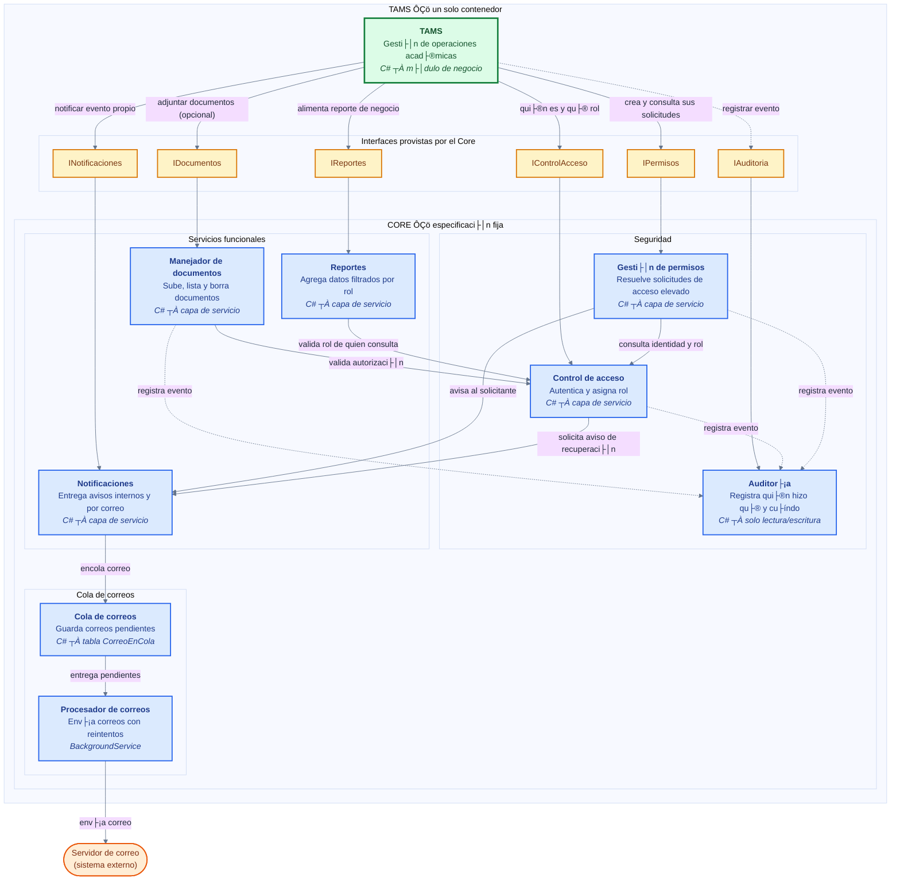

# TAMS
Sistema de Gesti├│n Acad├®mica Docente para la administraci├│n de asignaciones, cursos, horarios y calificaciones. Proyecto de Programaci├│n III.

## Requisitos previos

- .NET SDK 10
- SQL Server (local o accesible)
- La herramienta de migraciones de EF Core: `dotnet tool install --global dotnet-ef`
- Una cuenta de Mailtrap (o cualquier servidor SMTP) para el envío de correos

## Variables de entorno

Ninguna credencial está en el repositorio (RD-10). Defínelas con:

```powershell
[System.Environment]::SetEnvironmentVariable("NOMBRE","valor","User")
```

Cierra y abre VS Code por completo despu├®s de definir o cambiar cualquiera de estas.

| Variable | Para qu├® sirve |
|---|---|
| `TAMS_NEGOCIO_CONNECTION_STRING` | Cadena de conexi├│n del esquema `negocio` (m├│dulo TAMS) |
| `TAMS_CORE_CONNECTION_STRING` | Cadena de conexi├│n del esquema `core` (Control de acceso) |
| `TAMS_JWT_SECRETO` | Clave de firma de los tokens JWT de sesión (Base64, mínimo 32 bytes) |
| `TAMS_SMTP_HOST` | Host del servidor SMTP |
| `TAMS_SMTP_PORT` | Puerto del servidor SMTP |
| `TAMS_SMTP_USUARIO` | Usuario de autenticaci├│n SMTP |
| `TAMS_SMTP_CONTRASENA` | Contrase├▒a o token de autenticaci├│n SMTP |
| `TAMS_SMTP_REMITENTE` | Dirección "De" con la que se envían los correos |

## C├│mo arrancar el proyecto

```powershell
git clone https://github.com/soleyniesandovals-rgb/TAMS.git
cd TAMS
# define las 8 variables de entorno de arriba, cierra y abre VS Code

dotnet build TAMS.slnx
dotnet test TAMS.slnx   # prueba de arquitectura (RD-03): Passed: 1

# aplica las migraciones (crea las tablas si no existen)
dotnet ef database update --project src/Tams.Negocio --startup-project src/Tams.Api
dotnet ef database update --project src/Core --startup-project src/Tams.Api

cd src\Tams.Api
dotnet run
```

> Usa `dotnet run` (perfil `http`), no F5 desde Visual Studio: el perfil
> `https` redirige y rompe los enlaces de activaci├│n/recuperaci├│n, que
> apuntan a `http://localhost:5132`.

La API queda escuchando en `http://localhost:5132`.

## Crear el primer Administrador

El registro siempre crea cuentas con rol Estándar, y nadie puede autopromoverse (es una regla de diseño: así nunca se puede quedar el sistema sin Administradores por un cambio de rol accidental). Para tener el primer Administrador:

1. Regístrate normalmente: `POST /api/cuentas/registro`.
2. Procesa la cola de correos y activa la cuenta con el enlace recibido (ver abajo).
3. Asci├®ndela manualmente, una sola vez, con SQL:

```sql
UPDATE core.Usuarios SET Rol = 'Administrador' WHERE Correo = 'tu_correo@ejemplo.com';
```

## Procesar la cola de correos

Los correos (activación, recuperación de contraseña) nunca se envían dentro de la misma operación que los origina: se encolan en `core.CorreosEnCola` y un comando aparte los envía.

```powershell
cd src\Tams.Api
dotnet run -- procesar-correos
```

Ejecutarlo varias veces no duplica envíos (es idempotente). Se puede correr con el servidor SMTP apagado: la operación que generó el correo ya terminó bien, y el correo queda pendiente hasta que el SMTP vuelva a estar disponible.

## Pruebas

Para ejecutar toda la suite de pruebas desde un clon limpio:

```powershell
dotnet test TAMS.slnx
```

- Las pruebas de `tests/Tests.Permisos` usan implementaciones falsas en memoria (`ICoreUnidadDeTrabajo`, repositorios y `TimeProvider`), por lo que **no requieren SQL Server encendido ni variables de entorno** (RD-12).
- Las pruebas arquitectónicas se ejecutan junto a las unitarias en el mismo comando.

## C├│mo provocar cada criterio de aceptaci├│n

**Registro y activaci├│n**
- `POST /api/cuentas/registro` con un correo nuevo  se crea inactiva. Repetir con el mismo correo  se rechaza.
- `POST /api/cuentas/login` antes de activar  rechazado, indica cuenta inactiva.
- Procesar la cola, abrir el enlace recibido (`GET /api/cuentas/activar?codigo=...`)  activa la cuenta.
- Abrir el mismo enlace una segunda vez  se rechaza.
- `POST /api/cuentas/reenviar` con un correo que existe y con uno que no  misma respuesta en ambos casos.

**Sesi├│n**
- `POST /api/cuentas/login` con credenciales correctas  devuelve un JWT.
- Con contrase├▒a incorrecta y con correo inexistente ÔåÆ mismo mensaje de rechazo en los dos casos.
- `GET /api/cuentas/yo` sin token ÔåÆ 401. Con token v├ílido ÔåÆ datos del usuario.
- `POST /api/cuentas/logout` y luego reusar el mismo token en `/yo` ÔåÆ 401 (la sesi├│n qued├│ invalidada).
- 5 logins seguidos con contrase├▒a incorrecta, luego un sexto intento (aunque la contrase├▒a sea correcta) ÔåÆ rechazado, bloqueo de 15 minutos.

**Roles y administraci├│n** (requieren un token de Administrador, ver arriba)
- Con un token de Est├índar, invocar `GET /api/cuentas` o `PUT /api/cuentas/{id}/rol` directamente (sin pasar por ninguna interfaz) ÔåÆ 403.
- `PUT /api/cuentas/{id}/rol` como Administrador, sobre otro usuario  cambia el rol.
- Un Administrador intentando cambiarse su propio rol  409.
- `POST /api/cuentas/{id}/desactivar` ÔåÆ el usuario no puede iniciar sesi├│n y su sesi├│n abierta queda invalidada.
- Un Administrador intentando desactivarse a s├¡ mismo ÔåÆ 409.
- `GET /api/cuentas`  lista sin hashes ni tokens.

**Contrase├▒as**
- `POST /api/cuentas/recuperacion/iniciar` con un correo que existe y con uno que no  misma respuesta.
- Procesar la cola, recibir el c├│digo, `POST /api/cuentas/recuperacion/confirmar` ÔåÆ cambia la contrase├▒a. Reusar el mismo c├│digo ÔåÆ se rechaza.
- Login con la contrase├▒a anterior tras confirmar ÔåÆ 401. Con la nueva ÔåÆ funciona.
- `POST /api/cuentas/{id}/restablecer` como Administrador ÔåÆ la contrase├▒a anterior del usuario deja de servir de inmediato, incluso antes de que confirme un c├│digo nuevo.
- `POST /api/cuentas/cambiar-contrasena` con sesi├│n, indicando la actual ÔåÆ cambia la contrase├▒a y cierra las sesiones anteriores.

**Correo por cola**
- Apagar el acceso al SMTP (o usar credenciales inv├ílidas) y registrar un usuario ÔåÆ la operaci├│n termina bien, el correo queda "Pendiente".
- Ejecutar `dotnet run -- procesar-correos` dos veces seguidas ÔåÆ no duplica el env├¡o.

**Máquina de estados de negocio**
- Ver `docs/maquina-de-estados.md`: tabla de transiciones de `Calificacion`, con la transici├│n prohibida (`Publicada ÔåÆ Borrador`) y el estado terminal (`Cerrada`).

## Cómo provocar cada criterio de aceptación RF-GP

Todos los casos usan los endpoints reales de `PermisosController` (ruta `api/permisos`). Requiere un token JWT válido para el actor indicado.

> Nota: `Invoke-RestMethod` lanza excepción en respuestas no-2xx; para obtener el código exacto conviene usar `Invoke-WebRequest` con `try/catch`. En la tabla se indica el código HTTP esperado para cada caso.

### RF-GP-01: crear solicitud de permiso
- Método: `POST`
- Ruta: `/api/permisos`
- Autenticado como: **Estandar** (cualquier usuario autenticado)
- Body (JSON):
  ```json
  { "TipoPermiso": "acceso-reportes" }
  ```
- Código esperado: **201** (devuelve resumen de la solicitud creada; `estado = "Pendiente"`)

### RF-GP-02: listar solo solicitudes propias
- Método: `GET`
- Ruta: `/api/permisos`
- Autenticado como: **Estandar** (solo ve sus propias solicitudes)
- Body: ninguno
- Código esperado: **200** (lista únicamente las solicitudes del usuario autenticado)

### RF-GP-03: listar solicitudes pendientes (solo Administrador)
- Método: `GET`
- Ruta: `/api/permisos/pendientes`
- Autenticado como: **Administrador**
- Body: ninguno
- Código esperado: **200** (todas las solicitudes con `estado = "Pendiente"`)
- Caso de rechazo por autorización: si lo intenta un **Estandar** → **403** (el atributo `[RequiereRol]` bloquea antes del servicio)
- Aclaración: `GET /api/permisos` (sin `/pendientes`) es accesible para **cualquier usuario autenticado** (Estandar o Administrador) y siempre devuelve **solo las solicitudes propias** del que consulta; no debe confundirse con el endpoint de pendientes, que es exclusivo del Administrador.

### RF-GP-04: rechazar solicitud (motivo obligatorio)
1. Crear una solicitud pendiente (Estandar) → `POST /api/permisos` (201)
2. Intentar rechazar SIN motivo (Administrador, `POST /api/permisos/{id}/rechazar` con `{"motivo": ""}`) → **400** con mensaje `"El rechazo requiere un motivo."`
3. Rechazar CON motivo válido (Administrador, `{"motivo": "No corresponde al cargo."}`) → **200** (estado `"Rechazada"`, `motivoRechazo` guardado)

### RF-GP-05: aprobación aplica permiso automáticamente
1. Crear solicitud pendiente (Estandar) → 201
2. Verificar acceso ANTES de aprobar (Estandar, `GET /api/permisos/acceso/{tipoPermiso}`) → **403** (`Forbid()`)
3. Aprobar (Administrador, `POST /api/permisos/{id}/aprobar`) → **200** (aplicación automática en la misma llamada)
4. Verificar acceso DESPUÉS de aprobar (Estandar, `GET /api/permisos/acceso/{tipoPermiso}`) → **200** (`{"mensaje":"Acceso concedido."}`)

### RF-GP-06: transiciones válidas únicas (máquina de estados)
1. Aprobar una solicitud pendiente → 200 (pasa a `Aplicada` en la misma operación).
2. Intentar aprobar **la misma** solicitud nuevamente (Administrador) → **409** (transición `Aplicada → Aprobada` no permitida por `TransicionesPermiso`; mensaje `"No se permite pasar de Aplicada a Aprobada..."`).
3. `POST /api/permisos/{id}/rechazar` sobre una solicitud en estado `Rechazada` → **409** (transición `Rechazada → Rechazada` no habilitada en la máquina de estados; `TransicionNoPermitidaExcepcion` propagada tal cual).

### RF-GP-07: nadie resuelve su propia solicitud
1. El propio Administrador crea una solicitud (`POST /api/permisos` autenticado como Administrador) → 201
2. El mismo Administrador intenta aprobarla (`POST /api/permisos/{id}/aprobar`) → **409** con mensaje `"No puedes resolver tu propia solicitud."` (chequeo antes de validar la transición)
3. El mismo Administrador intenta rechazarla (`POST /api/permisos/{id}/rechazar` con motivo) → **409** con el mismo mensaje.

## Estructura del proyecto

```
src/
  Core/              Especificaci├│n fija del curso (Control de acceso)
  Permisos/          Módulo de gestión de permisos: solicitudes y permisos activos (RF-GP-01 a RF-GP-07)
  Tams.Negocio/       M├│dulo de negocio: gesti├│n acad├®mica
  Tams.Api/          API web, punto de entrada ├║nico
tests/
  Tests.Arquitectura/ Verifica que Core no dependa de Tams.Negocio (RD-03)
  Tests.Permisos/     Pruebas unitarias del servicio de permisos (dobles en memoria, RD-12)
docs/
  maquina-de-estados.md
  bitacora-asignacion-1.md
  bitacora-fase0-diagrama.md
  bitacora-practica-1.md
```

---

## Diagrama de componentes



### C├│mo leer el diagrama

| Elemento | Significado |
|---|---|
| Recuadro verde (`TAMS`) | El módulo de negocio: tu dominio, tus entidades y tu máquina de estados. |
| Recuadros amarillos | Las interfaces que expone el Core. Es lo ├║nico que TAMS puede usar de ├®l. |
| Recuadros azules | Las seis piezas del Core, con su responsabilidad y su tecnología. |
| Recuadro naranja (`Servidor de correo`) | Un sistema externo, fuera de la aplicaci├│n. |
| Flecha sólida (`-->`) | Una llamada directa: quien envía la flecha necesita una respuesta de quien la recibe para completar su operación. |
| Flecha punteada (`-.->`) | Un registro que no bloquea el flujo: se avisa a Auditoría, pero la operación no depende de esa respuesta. |
| Texto sobre la flecha | El prop├│sito de esa comunicaci├│n, no el nombre t├®cnico del m├®todo. |

No se dibuja ninguna base de datos ni volumen como componente: cada pieza
del Core guarda sus propios datos, de forma independiente y sin que otra
pieza pueda leerlos directamente (RD-01, RD-03).
