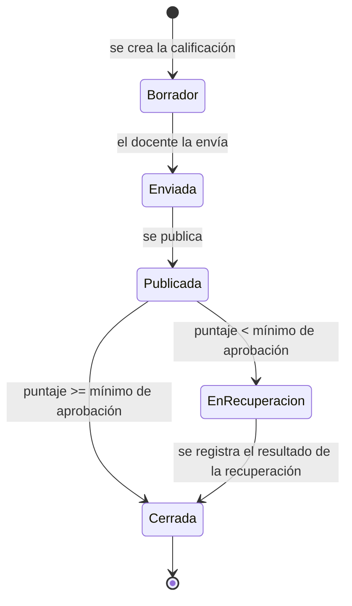

# Máquina de estados de la calificación

Diseño objetivo de la máquina de estados para la **Práctica 3**. Este documento fija las
transiciones, sus condiciones, quién las ejecuta, las siete operaciones del negocio y las
pruebas previstas. Los bloques de implementación lo toman como contrato; si al implementar
cambia una ruta, una condición o un nombre, este documento se actualiza en el mismo cambio.

## Dónde vive la regla

| Elemento | Ubicación |
|---|---|
| Estados | `src/Tams.Negocio/Domain/Enums/EstadoCalificacion.cs` (RF-NEG-03) |
| Transiciones permitidas | `src/Tams.Negocio/Domain/Maquinas/TransicionesCalificacion.cs` |
| Cambio de estado en la entidad | `Calificacion.CambiarEstado(...)` (delega en la máquina, no repite reglas) |
| Error de transición inválida | `src/Tams.Negocio/Domain/Excepciones/TransicionNoPermitidaExcepcion.cs` |

Las transiciones están declaradas en **un solo lugar** (RD-04): el diccionario de
`TransicionesCalificacion`. Ningún servicio ni controlador vuelve a listarlas, así que no
puede haber dos listas que se contradigan. La máquina vive en el dominio, no en el
controlador (RD-02).

## Estados

`Borrador` → `Enviada` → `Publicada` → `EnRecuperacion` → `Cerrada`

| Estado | Significado |
|---|---|
| `Borrador` | El docente está armando la calificación; todavía no se envía. Es el estado inicial. |
| `Enviada` | La calificación fue enviada y espera su publicación. |
| `Publicada` | El estudiante ya puede ver el puntaje. |
| `EnRecuperacion` | El puntaje no alcanzó el mínimo de aprobado y hay una recuperación pendiente. |
| `Cerrada` | La calificación quedó firme. **Estado terminal.** |

## Diagrama

La flecha `Publicada --> Borrador` **no** existe en el diagrama porque está prohibida.

## Transiciones permitidas

| Desde | Hacia | Quién la ejecuta | Condición |
|---|---|---|---|
| `Borrador` | `Enviada` | Docente titular | `PuntajeObtenido` entre 0 y 100, ambos incluidos. |
| `Enviada` | `Publicada` | Docente titular | Sin condición adicional. |
| `Publicada` | `EnRecuperacion` | Docente titular | `PuntajeObtenido` **menor** que el mínimo de aprobación (70 por defecto). |
| `Publicada` | `Cerrada` | Docente titular | `PuntajeObtenido` **mayor o igual** que el mínimo de aprobación (70 por defecto). |
| `EnRecuperacion` | `Cerrada` | Docente titular | `PuntajeRecuperacion` registrado, entre 0 y 100, ambos incluidos. |

Las dos salidas de `Publicada` son excluyentes según el mismo puntaje: o va a recuperación
o se cierra, nunca ambas. El mínimo de aprobación y el alcance de "docente titular" se
detallan más abajo.

## Transiciones prohibidas

| Desde | Hacia | Por qué |
|---|---|---|
| `Publicada` | `Borrador` | Una calificación publicada **no se despublica**: ya la vio el estudiante (RF-NEG-04). |
| `Cerrada` | cualquiera | `Cerrada` es el **estado terminal**: no hay ninguna transición de salida (RF-NEG-05). |

Además están prohibidas, porque el mapa de la máquina es exhaustivo, todas las combinaciones
que no aparecen en la tabla de permitidas: `Borrador` → `Publicada`, `EnRecuperacion` o
`Cerrada`; `Enviada` → `Borrador`, `EnRecuperacion` o `Cerrada`; `EnRecuperacion` →
`Borrador`, `Enviada` o `Publicada`; `Publicada` → `Enviada`; y cualquier salto de
`Borrador` o `Enviada` que se salte una etapa.

## Condiciones y quién ejecuta

### Mínimo de aprobación

El mínimo de aprobación es **70** y es el valor por defecto. Se define en **un solo lugar**
—una constante u opción de configuración del módulo de negocio—; ni la máquina de estados ni
los servicios lo repiten. La máquina lo recibe como parámetro y lo usa para decidir las dos
salidas de `Publicada`, de modo que cambiarlo no obliga a tocar las transiciones.

### Rango de los puntajes

`PuntajeObtenido` y `PuntajeRecuperacion` se expresan en la escala 0-100, ambos extremos
incluidos. Un puntaje fuera de rango no es una transición válida: se rechaza antes de cambiar
el estado.

### Docente titular

Una transición la ejecuta el **docente titular de la materia**, que es el usuario autenticado
cuyo `UsuarioId` coincide con el de la `AsignacionDocente` de:

- la **materia** de la calificación (`Calificacion.MateriaId`), y
- el **curso del estudiante** (`Calificacion.Estudiante.CursoId`).

La asignación es única por materia y curso, así que hay como máximo un docente titular. Si no
hay asignación que coincida, la operación se rechaza con **403** y no se toca el estado.

Esta comprobación **vive en el servicio de aplicación, no en la máquina**. La máquina de
estados solo conoce estados y condiciones de puntaje; no consulta usuarios, asignaciones ni
permisos. El servicio recibe el `usuarioId` ya autenticado por el host (claim `sub` del JWT) y
resuelve la titularidad contra las entidades de negocio. Así la máquina se puede probar sin
base de datos ni identidades, y la autorización queda en un único punto por operación.

## Funcionalidades del negocio

Las siete operaciones se exponen bajo `/api/calificaciones`, todas para usuarios
autenticados con rol **Estándar** (el docente). Las rutas son una propuesta de diseño y
pueden ajustarse al implementar.

| # | Operación | Ruta propuesta | Rol | Estados que toca |
|---|---|---|---|---|
| 1 | Registrar calificación | `POST /api/calificaciones` | Estándar | Crea en `Borrador`. |
| 2 | Enviar calificación | `POST /api/calificaciones/{id}/enviar` | Estándar | `Borrador` → `Enviada`. |
| 3 | Publicar calificación | `POST /api/calificaciones/{id}/publicar` | Estándar | `Enviada` → `Publicada`. |
| 4 | Enviar a recuperación | `POST /api/calificaciones/{id}/recuperacion` | Estándar | `Publicada` → `EnRecuperacion`. |
| 5 | Cerrar calificación | `POST /api/calificaciones/{id}/cerrar` | Estándar | `Publicada` → `Cerrada` o `EnRecuperacion` → `Cerrada`. |
| 6 | Corregir puntaje de una calificación publicada | `PATCH /api/calificaciones/{id}/puntaje` | Estándar + permiso `corregir-calificacion` | Sin cambio de estado: sigue en `Publicada`. |
| 7 | Consultar mis calificaciones | `GET /api/calificaciones/mias` | Estándar | Sin cambio de estado: solo lectura. |

Notas:

- **Registrar** valida el rango 0-100 y deja la calificación en el estado inicial `Borrador`;
  no es una transición del mapa, es la creación.
- **Enviar** exige que el puntaje esté entre 0 y 100.
- **Publicar** no agrega condición: la calificación ya fue enviada.
- **Enviar a recuperación** solo procede si el puntaje quedó por debajo del mínimo.
- **Cerrar** cubre las dos entradas al estado terminal: cierre directo desde `Publicada`
  (puntaje mayor o igual al mínimo) y cierre desde `EnRecuperacion` con el puntaje de la
  recuperación registrado y dentro de 0-100.
- **Corregir puntaje** no cambia el estado; se detalla en la sección siguiente.
- **Consultar mis calificaciones** devuelve solo las calificaciones del docente autenticado
  (las de las materias y cursos donde es titular) y no modifica nada.

## Operación que requiere permiso

**Corregir el puntaje de una calificación `Publicada`** exige el permiso
`corregir-calificacion`, concedido por Gestión de permisos:

1. El docente solicita el permiso en `POST /api/permisos` (RF-GP-01).
2. Un Administrador aprueba la solicitud; la aprobación aplica el permiso en la misma
   operación (RF-GP-03, RF-GP-05).
3. Con el permiso vigente, el docente llama a
   `PATCH /api/calificaciones/{id}/puntaje`.

El servicio de aplicación comprueba el permiso con
`IGestionPermisosServicio.TienePermisoAsync(usuarioId, "corregir-calificacion")` antes de
modificar el puntaje; si no lo tiene, responde **403**. La comprobación se hace además de la
titularidad: el permiso no sustituye a "docente titular", se suman.

La corrección **no cambia el estado**: la calificación sigue en `Publicada`. Solo actualiza
`PuntajeObtenido`, que debe quedar entre 0 y 100. No se registra una transición en la máquina
de estados; las salidas posteriores de `Publicada` volverán a evaluar el puntaje ya corregido.

El permiso se consulta a través de la interfaz que expone el Core, sin crear dependencias ni
claves foráneas hacia sus tablas (RD-03).

## Cómo se prueba cada fila

Las pruebas de la máquina son unitarias: construyen la calificación con el estado y el
puntaje indicados, llaman a `Calificacion.CambiarEstado(...)` o a
`TransicionesCalificacion.Exigir(...)` y verifican el estado final o la excepción. No
necesitan base de datos ni usuarios. El mínimo de aprobación se pasa como 70 en las pruebas
de las condiciones que lo usan.

| Fila | Tipo | Prueba propuesta | Qué comprueba |
|---|---|---|---|
| `Borrador` → `Enviada` | Permitida | `Transicion_Borrador_a_Enviada_conPuntajeValido_cambiaElEstado` | Con 0, con 100 y con un valor intermedio, el estado termina en `Enviada`. |
| `Borrador` → `Enviada` | Condición | `Transicion_Borrador_a_Enviada_conPuntajeFueraDeRango_lanzaExcepcion` | Con -1 o 101 lanza `TransicionNoPermitidaExcepcion` y el estado no cambia. |
| `Enviada` → `Publicada` | Permitida | `Transicion_Enviada_a_Publicada_cambiaElEstado` | Sin condición adicional: el estado termina en `Publicada`. |
| `Publicada` → `EnRecuperacion` | Permitida | `Transicion_Publicada_a_EnRecuperacion_conPuntajeBajoElMinimo_cambiaElEstado` | Con 69 (mínimo 70) el estado termina en `EnRecuperacion`. |
| `Publicada` → `EnRecuperacion` | Condición | `Transicion_Publicada_a_EnRecuperacion_conPuntajeEnElMinimo_lanzaExcepcion` | Con 70 no procede la recuperación: lanza excepción. |
| `Publicada` → `Cerrada` | Permitida | `Transicion_Publicada_a_Cerrada_conPuntajeEnElMinimo_cambiaElEstado` | Con 70 (mínimo 70) el estado termina en `Cerrada`. |
| `Publicada` → `Cerrada` | Condición | `Transicion_Publicada_a_Cerrada_conPuntajeBajoElMinimo_lanzaExcepcion` | Con 69 no procede el cierre directo: lanza excepción. |
| `EnRecuperacion` → `Cerrada` | Permitida | `Transicion_EnRecuperacion_a_Cerrada_conPuntajeRecuperacion_cambiaElEstado` | Con `PuntajeRecuperacion` registrado (0, 100 o intermedio) el estado termina en `Cerrada`. |
| `EnRecuperacion` → `Cerrada` | Condición | `Transicion_EnRecuperacion_a_Cerrada_sinPuntajeRecuperacion_lanzaExcepcion` | Con `PuntajeRecuperacion` nulo lanza excepción. |
| `EnRecuperacion` → `Cerrada` | Condición | `Transicion_EnRecuperacion_a_Cerrada_conPuntajeRecuperacionFueraDeRango_lanzaExcepcion` | Con -1 o 101 lanza excepción. |
| `Publicada` → `Borrador` | Prohibida | `Transicion_Publicada_a_Borrador_lanzaExcepcion` | Lanza `TransicionNoPermitidaExcepcion` y la calificación sigue en `Publicada`. |
| `Cerrada` → cualquiera | Prohibida | `Transicion_Cerrada_a_CualquierEstado_lanzaExcepcion` | `[Theory]` con los cuatro estados restantes: todos lanzan excepción y sigue en `Cerrada`. |
| `Cerrada` | Estado terminal | `Estado_Cerrada_esTerminal` | `EsTerminal(Cerrada)` es `true` y `PermitidosDesde(Cerrada)` está vacío. |

Las pruebas de titularidad y de permiso no son filas de la máquina: se prueban en el servicio
de aplicación, con dobles de `IGestionPermisosServicio` y de las asignaciones, y verifican
403/éxito sin depender de la base de datos.

## Notas de implementación

- **Mínimo de aprobación:** 70 por defecto, configurable en un solo lugar. La máquina lo
  recibe como parámetro (`TransicionesCalificacion.Exigir(...)` y
  `Calificacion.CambiarEstado(...)`); no hay un 70 repetido en el código ni en las
  transiciones.
- **Rango de puntajes:** 0-100, ambos incluidos, para `PuntajeObtenido` y
  `PuntajeRecuperacion`. Se valida antes de cambiar el estado.
- **Quién ejecuta:** la máquina valida estados y condiciones de puntaje. La titularidad
  (`UsuarioId` de la `AsignacionDocente` de la materia y del curso del estudiante) y el
  permiso `corregir-calificacion` se comprueban en el servicio de aplicación, que recibe el
  `usuarioId` autenticado desde el host. Ni la máquina ni las entidades conocen usuarios,
  roles ni permisos.
- **Estado inicial:** una calificación nace en `Borrador`
  (`CalificacionConfiguracion` lo define como valor por defecto).
- **Diseño, no implementación cerrada:** las rutas HTTP son propuestas y los nombres de las
  pruebas son orientativos; lo que no cambia sin actualizar este documento son los estados,
  las cinco transiciones permitidas, las prohibidas y las condiciones.